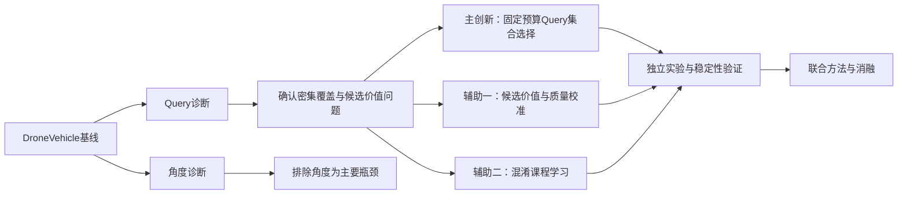

<h1 align="center">O²-RTDETR × DroneVehicle</h1>

<p align="center"><strong>密集长尾航拍车辆旋转检测：基线复现、机制诊断与正式创新研究</strong></p>

<p align="center">
  
  
  
  
  
  
</p>

<p align="center"><strong>📚 项目文档导航</strong></p>

<p align="center">
  <a href="README.md"></a>
  <a href="README_OFFICIAL.md"></a>
  <a href="README_TEAMWORK.md"></a>
</p>

---

本仓库以 **O²-RTDETR-R18** 为基线，在 **DroneVehicle RGB** 单模态数据集上研究密集、长尾、易混车辆的旋转目标检测。当前已经完成基线正式训练、验证集选权重、测试集评估、Query Selection专项诊断和角度专项诊断，研究工作正式进入创新机制设计与实验阶段。

本README直接记录：基线配置与结果、两项专项诊断、基线暴露的真实问题、已排除的方向、当前研究方向、一个主创新与两个辅助创新，以及后续实验与稳定性标准。

> [!NOTE]
> 原论文与官方工程介绍保存在 [README_OFFICIAL.md](README_OFFICIAL.md)。本文档记录的是当前仓库基于DroneVehicle开展的研究工作，不代表O²-RTDETR原作者的官方结论。

---

## 1. 当前研究状态

- [x] O²-RTDETR工程与依赖环境配置
- [x] DroneVehicle RGB数据提取、标注检查与旋转框加载
- [x] 单卡8 GB训练配置适配
- [x] 12、24、36轮余弦退火实验
- [x] 36轮正式基线训练
- [x] 验证集选择最佳权重 `epoch_33.pth`
- [x] 测试集正式评估与预测导出
- [x] Query Selection专项诊断
- [x] 角度误差与角度扰动专项诊断
- [x] 确定正式研究问题和创新方向
- [ ] 主创新最小可行实现
- [ ] 两个辅助创新独立实验
- [ ] 完整方法联合训练
- [ ] 消融、效率和跨数据集验证



---

## 2. 研究定位

### 2.1 总体方向

> **面向密集长尾航拍车辆的质量感知Query分配与混淆鲁棒旋转检测。**

研究约束：

- 保持O²-RTDETR端到端旋转检测框架；
- 保持R18轻量骨干；
- 保持300个Decoder Query；
- 不依赖增加Query数量或扩大Backbone获得主要提升；
- 尽量保持原模型实时性；
- 重点改善密集场景和少数易混类别。

### 2.2 核心研究问题

原模型使用Encoder候选的最大类别分数执行全局Top-K，从全部Encoder候选中选择300个进入Decoder。该机制默认最大类别分数能够代表候选实际价值、候选可以被独立评价、固定全局Top-K能够适应不同场景密度。诊断结果表明，这些假设在密集、长尾、易混车辆场景中并不完全成立。

当前研究要回答：

> **在固定300个Query和实时性约束下，如何更准确地评价候选价值，如何选择一组覆盖更充分、冗余更低的Query，以及如何让模型正确处理几何可靠但语义易混的少数类候选。**

---

## 3. 数据集

### 3.1 主数据集：DroneVehicle RGB

当前研究只使用DroneVehicle的RGB图像和五类旋转框标注，不使用红外图像，不属于多模态检测。

| 划分 | 图片数 | 目标数 | 用途 |
|---|---:|---:|---|
| Train | 17,990 | 286,791 | 模型训练 |
| Validation | 1,469 | 22,462 | 选择权重、机制诊断和创新调参 |
| Test | 8,980 | 143,312 | 最终基线与最终创新模型评估 |

训练集类别分布：

| 类别 | 英文 | 训练实例数 | 占比 |
|---|---|---:|---:|
| 小汽车 | Car | 246,698 | 86.02% |
| 卡车 | Truck | 13,685 | 4.77% |
| 公交车 | Bus | 10,421 | 3.63% |
| 厢式车 | Van | 7,275 | 2.54% |
| 货运车 | Freight Car | 8,712 | 3.04% |

该数据集同时具有长尾分布、密集场景和类别相似三个特征。Car占据绝大多数训练样本；部分图像包含大量相邻车辆；Van与Car、Freight Car与Truck具有明显外观相似性。

### 3.2 辅助数据集：L315_vehicle

L315作为已完成的辅助基线，用于后续验证创新方法是否只对DroneVehicle有效。L315相对简单，不作为当前主数据集。

---

## 4. DroneVehicle基线配置

| 项目 | 设置 |
|---|---|
| 模型 | O²-RTDETR-R18-vd |
| 模态 | RGB单模态 |
| 类别数 | 5 |
| 输入尺寸 | 保持长宽比缩放并填充至1024 × 1024 |
| Query数量 | 300 |
| 总训练轮数 | 36 |
| 最佳验证轮次 | Epoch 33 |
| 训练batch size | 4 |
| 梯度累积 | 2 |
| 有效batch size | 8 |
| DataLoader workers | 2 |
| 混合精度 | AMP，动态损失缩放 |
| 优化器 | AdamW |
| 学习率策略 | 2000 iteration线性预热＋36轮余弦退火 |
| 验证频率 | 每轮验证 |
| GPU | NVIDIA GeForce RTX 4070 Laptop GPU 8 GB |
| 完整训练耗时 | 约15小时32分钟 |

基线配置与权重：

```text
projects/rotated_rtdetr/configs/o2_rtdetr_r18vd_1xb4_36e_cosine_amp_dronevehicle.py
work_dirs/dronevehicle_o2_rtdetr_r18_36e_cosine_amp_b4_baseline/epoch_33.pth
```

---

## 5. 基线结果

### 5.1 整体结果

| 数据划分 | 权重 | mAP | AP50 |
|---|---|---:|---:|
| Validation | epoch_33.pth | 70.88% | 约70.9% |
| Test | epoch_33.pth | **70.82%** | **约70.8%** |

### 5.2 测试集分类结果

| 类别 | GT | Recall | AP |
|---|---:|---:|---:|
| Car | 124,111 | 96.29% | **89.48%** |
| Truck | 7,102 | 92.66% | **68.21%** |
| Bus | 4,161 | 97.48% | **88.68%** |
| Van | 3,960 | 96.59% | **58.18%** |
| Freight Car | 3,978 | 90.75% | **49.56%** |
| **mAP** | 143,312 | — | **70.82%** |

### 5.3 结果结论

- Car和Bus AP接近89%，已经处于较高水平；
- Truck仍有明显提升空间；
- Van和Freight Car是拉低宏平均mAP的主要类别；
- Van召回率达到96.59%，但AP仅58.18%；
- Freight Car召回率达到90.75%，但AP仅49.56%；
- 主要瓶颈不是所有车辆都检测不到，而是少数易混类别的判别、置信度排序和密集场景候选质量不足。

### 5.4 L315辅助基线

| 数据集 | 最佳轮次 | Validation mAP | Test mAP | 训练耗时 |
|---|---:|---:|---:|---:|
| L315_vehicle | 31 | 83.46% | 83.29% | 12小时10分49秒 |
| DroneVehicle RGB | 33 | 70.88% | 70.82% | 约15小时32分钟 |

DroneVehicle明显比L315更困难，因此被确定为主研究数据集。

---

## 6. Query Selection诊断结果

诊断使用DroneVehicle验证集1469张图像、22,462个GT，分析K=100、200、300、400时的Encoder候选覆盖、类别正确覆盖和密度差异。

### 6.1 K=300整体结果

| 类别 | 几何覆盖率 | 类别正确覆盖率 | 差距 |
|---|---:|---:|---:|
| Car | 93.19% | 92.44% | 0.75% |
| Truck | 82.71% | 69.09% | 13.62% |
| Bus | 97.74% | 92.68% | 5.06% |
| Van | 95.14% | 58.43% | **36.71%** |
| Freight Car | 90.00% | 53.38% | **36.62%** |

### 6.2 密度分组结果

| 类别 | 稀疏场景几何覆盖 | 中等场景几何覆盖 | 密集场景几何覆盖 |
|---|---:|---:|---:|
| Car | 98.41% | 98.10% | 90.81% |
| Truck | 96.37% | 95.01% | **71.29%** |
| Bus | 96.09% | 98.65% | 97.55% |
| Van | 100.00% | 96.54% | 93.75% |
| Freight Car | 95.06% | 95.48% | **85.75%** |

密集场景K=300时：

| 类别 | 几何覆盖率 | 类别正确覆盖率 | 差距 |
|---|---:|---:|---:|
| Car | 90.81% | 90.15% | 0.66% |
| Truck | 71.29% | 55.30% | 15.99% |
| Bus | 97.55% | 90.18% | 7.37% |
| Van | 93.75% | 52.40% | **41.35%** |
| Freight Car | 85.75% | 41.73% | **44.02%** |

### 6.3 Query数量对照

| 类别 | Recall@300 | Recall@400 | 提升 |
|---|---:|---:|---:|
| Car | 93.19% | 93.46% | +0.27% |
| Truck | 82.71% | 83.08% | +0.37% |
| Bus | 97.74% | 97.87% | +0.13% |
| Van | 95.14% | 95.14% | 0.00% |
| Freight Car | 90.00% | 90.42% | +0.42% |

### 6.4 Top-300预测类别组成

| 预测类别 | 候选占比 |
|---|---:|
| Car | 52.51% |
| Truck | 15.83% |
| Bus | 6.39% |
| Van | 7.79% |
| Freight Car | 17.48% |

### 6.5 Query诊断结论

- 300个Query总量不是主要瓶颈；
- 增加到400不能有效解决问题；
- 没有证据支持“Car占满全部Query”的原假设；
- 固定、类别分数驱动的全局Top-K在密集场景中出现候选覆盖下降；
- Truck和Freight Car的密集场景覆盖问题最突出；
- Van和Freight Car大量候选位置正确，但类别判断错误；
- 原始最大类别分数不能完整代表候选是否值得占用Decoder Query。

诊断产物：

```text
tools/analyze_query_selection.py
work_dirs/dronevehicle_query_diagnosis/
```

---

## 7. 角度诊断结果

角度诊断使用DroneVehicle测试集8980张图像、143,312个GT。预测框与GT采用同类别、一对一、置信度优先匹配，并处理旋转框180°周期和“宽高互换＋90°”等价表示。

### 7.1 实际角度误差（IoU ≥ 0.5）

| 类别 | 平均误差 | 中位误差 | P90误差 | 误差≤5°比例 |
|---|---:|---:|---:|---:|
| Overall | 2.34° | 1.59° | 5.02° | 89.92% |
| Car | 2.38° | 1.62° | 5.11° | 89.50% |
| Truck | 2.12° | 1.48° | 4.47° | 92.17% |
| Bus | **1.49°** | **1.08°** | **3.30°** | **97.09%** |
| Van | 2.29° | 1.64° | 4.99° | 90.01% |
| Freight Car | 2.13° | 1.51° | 4.63° | 91.43% |

### 7.2 密度分组角度误差

| 场景 | 平均误差 | 中位误差 | P90误差 | 平均旋转IoU |
|---|---:|---:|---:|---:|
| Sparse | 1.83° | 1.28° | 3.89° | 0.8328 |
| Medium | 2.12° | 1.46° | 4.54° | 0.8218 |
| Dense | 2.47° | 1.68° | 5.31° | 0.7952 |

### 7.3 角度扰动结果

| 人工扰动 | 平均IoU | IoU ≥ 0.5 | IoU ≥ 0.75 |
|---:|---:|---:|---:|
| 0° | 1.000 | 100.00% | 100.00% |
| 2° | 0.953 | 约100.00% | 约100.00% |
| 5° | 0.890 | 约100.00% | 99.84% |
| 10° | 0.801 | 99.98% | 94.81% |
| 15° | 0.728 | 99.09% | 27.35% |
| 20° | 0.666 | 97.42% | 1.18% |

### 7.4 角度诊断结论

- 模型整体平均角度误差仅约2.34°；
- 约90%的成功匹配框角度误差不超过5°；
- Truck、Bus和Freight Car没有表现出严重的角度回归问题；
- 密集场景角度误差仅比稀疏场景平均增加约0.64°；
- 大角度扰动会影响高IoU定位，但这是旋转矩形的自然几何敏感性；
- 当前没有证据支持将角度回归作为主要性能瓶颈；
- 后续不优先修改ADR，不增加独立角度损失，不把角度作为主创新。

诊断产物：

```text
tools/analyze_angle_robustness.py
work_dirs/dronevehicle_angle_diagnosis/
```

---

## 8. 基线暴露出的核心问题

### 8.1 最大类别分数不等于候选实际价值

原始Query Selection使用Encoder候选的最大类别分数进行Top-K。该分数主要表达模型当前的类别倾向，却同时被用来决定候选是否值得占用有限的Decoder Query位置。它混淆了目标存在性、类别可靠性和定位质量。几何定位正确但类别暂时不确定的Van或Freight Car候选，可能仍然值得进入Decoder继续细化。

### 8.2 独立Top-K缺少集合关系

原始Top-K不考虑已经选择了哪些候选、当前候选是否覆盖新区域、是否与已选候选重复、密集区域是否仍存在未覆盖目标，以及剩余Query预算应如何分配。因此Query总量达到300并不代表这些Query被有效使用。

### 8.3 固定全局选择不适应场景密度

同样的300个Query应用于稀疏、中等和密集图像，但密集场景候选竞争更强。Truck和Freight Car在密集场景中的几何覆盖显著下降，表明原选择机制缺少密度适应能力。

### 8.4 易混少数类缺少细粒度语义监督

Van和Freight Car的几何覆盖较高，但类别正确覆盖和最终AP很低。Van容易被识别为Car，Freight Car容易与Truck混淆；Car又占训练集约86%。原OCD以几何噪声为主，没有利用动态类别混淆关系训练困难候选。

### 8.5 训练目标与Query选择用途存在错位

Encoder分类分支主要通过分类与检测目标训练，但推理时其最大类别分数被直接用作Query价值。模型没有被明确训练去优化Top-300有效覆盖、密集场景覆盖、候选冗余、候选进入Decoder后的实际收益，以及几何可靠但语义不确定候选的保留价值。

---

## 9. 已排除或暂不优先的方向

| 方向 | 当前判断 | 原因 |
|---|---|---|
| 直接增加Query数量 | 不采用 | 300→400几乎没有改善覆盖 |
| “Car占满300个Query” | 不成立 | Top-300预测为Car约52.51%，没有直接证据支持 |
| 修改ADR或增加角度损失 | 不优先 | 实际平均角度误差仅约2.34° |
| 更大Backbone | 不作为创新 | 增加计算且不能解决机制问题 |
| RGB-IR双流 | 暂不采用 | 会改变当前单模态研究范围 |
| 固定类别权重 | 不作为主创新 | 通用性弱，可能导致少数类过拟合 |
| 简单密度分数加权 | 不足以构成主创新 | 仍属于人工重加权和独立排序 |
| 堆叠注意力/FPN模块 | 不采用 | 难以解释性能来源和保持实时性 |

---

## 10. 正式研究方向与创新结构

正式研究方向确定为：

> **研究固定Query预算下的候选价值评估、密度覆盖集合选择和易混候选学习，在尽量保持实时性的条件下，提高密集长尾航拍车辆旋转检测性能。**

当前阶段明确拆分为：

1. **主创新：密度覆盖约束的固定预算Query集合选择；**
2. **辅助创新一：候选价值学习与分类—定位质量校准；**
3. **辅助创新二：混淆驱动的课程式困难候选学习。**

三个方向先独立研究、独立验证，再决定最终论文中如何统一。现阶段不为了论文叙事提前强行合并。

---

## 11. 主创新：密度覆盖约束的固定预算Query集合选择

### 要解决的问题

原始Top-K只根据单个候选自己的最大类别分数排序，不考虑候选之间的覆盖和冗余关系。Query诊断已经证实密集场景中的候选覆盖下降，且增加Query总量不能有效解决。

### 创新目标

在Query总数仍为300的条件下，使进入Decoder的候选集合：

- 对密集目标覆盖更充分；
- 对不同空间区域分配更合理；
- 减少集中在同一目标或局部区域的冗余候选；
- 保留能够提供新目标覆盖的候选；
- 不损害稀疏场景和高精度类别；
- 不显著增加推理时间。

### 与简单密度加权的区别

本方向不能停留在“分类分数加密度权重”。真正的研究重点是：候选价值不再完全独立；候选是否值得选择与已经选择的候选有关；首个覆盖新目标或新区域的候选价值更高；重复覆盖同一区域的后续候选价值应下降；选择过程直接面向完整的300个Query集合。

### 修改范围

优先只替换Encoder到Decoder之间的Query选择部分，保持Backbone、Encoder主体、Decoder、ADR、Chamfer匹配和Query数量不变。

### 评价指标

- Encoder几何Recall@300；
- 密集场景Recall@300；
- Truck和Freight Car覆盖率；
- 未覆盖GT比例和候选冗余率；
- 密集子集mAP与总体mAP；
- FPS、延迟、显存和参数量。

### 成功标准

- 密集场景覆盖稳定提高；
- Truck和Freight Car覆盖明显改善；
- 总体mAP不下降并获得正向提升；
- Car和Bus AP基本保持；
- Query保持300；
- FPS下降尽量控制在5%～10%以内。

### 主要风险

- 密度估计错误会保留更多背景；
- 过度追求空间均匀会损害真实密集区域；
- 冗余抑制过强会删除相邻车辆；
- 集合选择过于复杂会损害实时性；
- 覆盖提高不一定自动转化为最终AP提高。

---

## 12. 辅助创新一：候选价值学习与分类—定位质量校准

### 要解决的问题

原始最大类别分数不能同时表示目标存在性、类别可靠性和定位质量。当前基线召回高但AP偏低，说明正确候选可能存在，但排序与质量判断仍有问题。

### 创新目标

学习比最大类别分数更可靠的候选价值，使模型能够区分：

- 高置信、高定位质量候选；
- 分类分数高但定位一般的候选；
- 定位可靠但类别暂时不确定、仍值得进入Decoder的候选；
- 重复候选与真实背景候选；
- 进入Decoder后有较大修正价值的候选。

### 独立实验方式

第一阶段仍保留原始Top-K，只替换Top-K使用的排序依据。这样可以在不引入集合选择复杂性的情况下验证候选价值是否比最大类别分数可靠、AP能否在召回基本不变时提高，以及训练和推理是否稳定。

### 与主创新的关系

辅助创新一为主创新提供单候选基础价值，主创新在此基础上进一步考虑候选之间的覆盖与冗余。

### 评价指标

- 总mAP和各类别AP；
- 置信度与旋转IoU相关性；
- 高置信错误率；
- 类别正确Recall@300；
- 正确预测的置信度排序；
- 召回率与推理速度变化。

### 成功标准

- 召回率基本保持；
- mAP稳定提升；
- Van、Freight Car和Truck AP提高；
- 高质量正确框排序上升；
- 高置信错误减少；
- 不依赖人工类别配额。

### 主要风险

- 新质量信号与分类分数高度重复；
- 质量监督不稳定导致训练震荡；
- 过度强调定位质量损害分类；
- 只改善排序但无法改善密集覆盖。

---

## 13. 辅助创新二：混淆驱动的课程式困难候选学习

### 要解决的问题

Van和Freight Car的几何覆盖较高，但类别正确覆盖与AP很低。原始OCD主要处理几何噪声，没有利用模型当前真实混淆关系。

### 创新目标

根据训练过程中动态产生的混淆和错误，逐步训练模型处理：

- Van与Car；
- Freight Car与Truck；
- 几何正确但类别错误的候选；
- 高置信错误候选；
- 分类间隔较小的困难候选；
- 密集区域中的易混目标。

### 课程式训练原则

- **训练前期**：保持原始几何学习为主，优先确保稳定收敛；
- **训练中期**：逐步加入动态混淆统计发现的易混类别候选；
- **训练后期**：重点利用高置信错误、低分类间隔、几何正确但类别错误的困难候选。

### 与主创新的关系

辅助创新二训练模型正确评价和处理易混候选，为辅助创新一提供更可靠的语义信息，使主创新不会因为类别暂时不确定而删除有价值候选，并提高候选进入Decoder后的最终分类正确率。

### 评价指标

- Van、Freight Car和Truck AP；
- 类别正确Recall@300；
- Van→Car与Freight Car→Truck错误率；
- 高置信错误率和混淆矩阵；
- Car和Bus AP；
- 训练损失与梯度稳定性。

### 成功标准

- Van和Freight Car AP明显提高；
- 主要混淆类别对错误下降；
- 类别正确Recall@300提高；
- Car和Bus不明显下降；
- 推理阶段几乎不增加额外计算；
- 不永久写死人工类别关系。

### 主要风险

- 困难样本加入过早破坏收敛；
- 少数类样本较少导致过拟合；
- 固定混淆类别对降低通用性；
- 过强困难负样本降低召回率；
- 与候选价值监督重复或冲突。

---

## 14. 三个创新方向的关系

当前阶段三者保持清晰拆分：

```text
辅助创新一：候选价值学习
解决“单个候选值不值得保留”
                  ↓
主创新：固定预算Query集合选择
解决“300个Query如何整体分配”
                  ↓
300个Query进入原始Decoder
                  ↓
辅助创新二：混淆课程学习
解决“候选如何分清相似车辆类别”
```

从实验角度三者必须能够单独开启、单独关闭和独立评价。只有分别证明有效后，才进行联合训练并决定最终论文叙事。

---

## 15. 创新实验顺序与消融矩阵

### 阶段一：候选价值最小实验

保持原始Top-K和300个Query，只替换候选排序依据。验证候选价值学习是否稳定、AP能否在召回基本不变时提高、质量信号是否优于最大类别分数。

### 阶段二：主创新最小实验

在尽量简单的候选价值基础上实现固定预算集合选择。验证密集覆盖、候选冗余、Query利用率和推理开销。

### 阶段三：混淆学习独立实验

保持原始Query Selection，只修改困难候选训练策略。验证Van、Freight Car和Truck提升、主要混淆关系变化及训练稳定性。

### 阶段四：逐步联合

| 实验 | 候选价值 | 集合选择 | 混淆学习 | 目的 |
|---|---:|---:|---:|---|
| Baseline | × | × | × | 原始基线 |
| A | ✓ | × | × | 验证辅助创新一 |
| B | × | ✓ | × | 验证主创新最小版本 |
| C | × | × | ✓ | 验证辅助创新二 |
| A+B | ✓ | ✓ | × | 验证质量与分配协同 |
| A+C | ✓ | × | ✓ | 验证质量与语义协同 |
| B+C | × | ✓ | ✓ | 验证覆盖与语义协同 |
| A+B+C | ✓ | ✓ | ✓ | 完整方法 |

---

## 16. 训练与稳定性控制

创新阶段固定以下基线条件：

| 项目 | 固定设置 |
|---|---|
| 数据集划分 | DroneVehicle现有Train/Val/Test |
| Backbone | R18-vd |
| 输入 | 1024 × 1024 |
| Query数量 | 300 |
| 物理batch | 4 |
| 梯度累积 | 2 |
| 有效batch | 8 |
| 优化器 | AdamW |
| 训练上限 | 36轮 |
| 学习率策略 | 线性预热＋余弦退火 |
| AMP | 开启 |
| 权重选择 | Validation最佳mAP |

每项创新遵循：

1. 静态代码和配置检查；
2. 少量图片前向测试；
3. 1轮冒烟训练；
4. 6或12轮趋势实验；
5. 只有稳定且呈正向趋势时才训练完整36轮；
6. 完整实验从统一初始化重新训练；
7. 不使用测试集选择超参数或权重。

稳定性检查包括：loss无NaN/Inf、梯度范数无持续异常、AMP loss scale不持续崩溃、显存无持续增长、候选不会全部集中在少数区域、Car和Bus不会在早期明显崩塌、密集覆盖提高时假阳性不会失控、FPS与延迟开销可接受。

---

## 17. 研究目标

以下是研究目标，不是结果保证。

### 精度目标

- 总mAP提升2～5个百分点可视为初步有效；
- 理想目标为提升4～7个百分点；
- Truck AP提高3～6个百分点；
- Van AP提高5～10个百分点；
- Freight Car AP提高8～12个百分点；
- Car和Bus AP下降尽量不超过1个百分点。

### 机制目标

- 提高密集场景Encoder Recall@300；
- 缩小Truck和Freight Car的稀疏—密集覆盖差距；
- 缩小Van、Freight Car的几何覆盖—类别正确覆盖差距；
- 降低候选冗余和未覆盖GT比例；
- 提高候选价值与真实定位质量的一致性；
- 降低高置信类别错误；
- 证明提升不是来自增加Query或扩大Backbone。

### 效率目标

- Query保持300；
- 参数增长尽量小；
- FPS下降尽量控制在5%～10%以内；
- 显存增长保持8 GB设备可运行；
- 辅助创新二尽量不增加推理开销。

---

## 18. 创新性判定标准

### 创新性不足

- 分类分数简单乘密度权重；
- 多个分数人工加权后继续普通Top-K；
- 只为Van和Freight Car设置固定权重；
- 只在DroneVehicle上有效；
- 只报告mAP，不报告Query机制指标；
- 通过增加Query、Backbone或计算量获得提升。

### 可以形成方法贡献

- 原始独立Top-K被真正替换；
- 候选价值获得直接学习和验证；
- 选择过程考虑已选候选、空间覆盖和冗余；
- 训练目标与Query选择用途更加一致；
- 不使用硬编码类别配额；
- 密集子集和少数类别稳定提升；
- 在L315上获得辅助泛化验证；
- 最好能迁移到另一种DETR基线；
- 精度提升与效率代价均有完整分析。

---

## 19. 重要文件与实验产物

| 文件或目录 | 作用 |
|---|---|
| `README_OFFICIAL.md` | 官方论文与工程介绍 |
| `projects/rotated_rtdetr/configs/o2_rtdetr_r18vd_1xb4_36e_cosine_amp_dronevehicle.py` | DroneVehicle 36轮基线配置 |
| `work_dirs/dronevehicle_o2_rtdetr_r18_36e_cosine_amp_b4_baseline/epoch_33.pth` | 最佳基线权重 |
| `work_dirs/dronevehicle_query_diagnosis/final_predictions.pkl` | 测试集结构化预测与GT |
| `tools/analyze_query_selection.py` | Query Selection诊断脚本 |
| `work_dirs/dronevehicle_query_diagnosis/` | Query诊断结果 |
| `tools/analyze_angle_robustness.py` | 角度误差与扰动诊断脚本 |
| `work_dirs/dronevehicle_angle_diagnosis/` | 角度诊断结果 |

> [!IMPORTANT]
> `work_dirs`通常不提交Git。权重、预测PKL、日志和大型诊断结果应通过网盘、局域网或实验服务器共享，并记录对应配置和权重哈希，避免团队成员使用不同产物。

---

## 20. 当前最终结论

基于DroneVehicle正式基线、Query诊断和角度诊断，目前可以确定：

1. DroneVehicle是主研究数据集，L315作为辅助泛化验证数据集；
2. 300个Query数量不是主要瓶颈，直接增加到400基本无效；
3. 原始最大类别分数Top-K不能完整表达候选实际价值；
4. 密集场景中Truck和Freight Car候选覆盖显著下降；
5. Van和Freight Car大量候选位置正确，但语义分类错误；
6. 角度回归整体正常，不是当前主要性能瓶颈；
7. 正式创新阶段保留一个主创新和两个辅助创新。

最终研究结构：

> **主创新：密度覆盖约束的固定预算Query集合选择。**

> **辅助创新一：候选价值学习与分类—定位质量校准。**

> **辅助创新二：混淆驱动的课程式困难候选学习。**

接下来不再继续寻找新的创新方向，而是依次完成三个方向的最小可行实现、独立实验、稳定性验证和联合消融。最终论文只保留具有稳定增益、明确机制证据和可接受实时性代价的组成部分。

