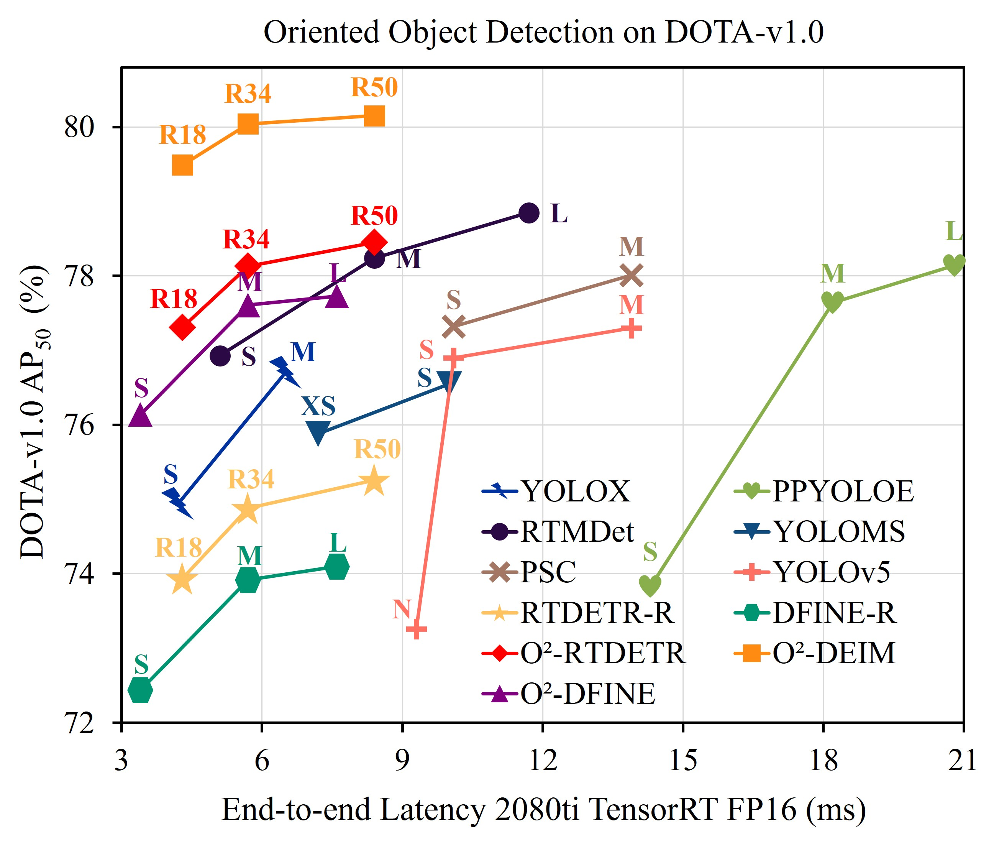
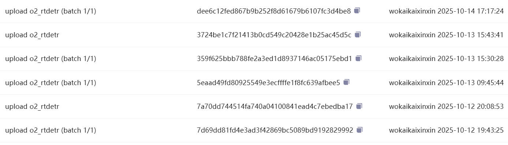

<h1 align="center">遥感图像实时旋转目标检测 Transformer</h1>
<p align="center"><strong>Real-Time Oriented Object Detection Transformer in Remote Sensing Images</strong></p>
<p align="center">IEEE TGRS 2026 · 🔥 ESI 高被引论文</p>

<p align="center">
  
  <a href="https://github.com/wokaikaixinxin/O2-RT-DETR/stargazers"></a>
  
  
</p>

<p align="center">
  <a href="https://ieeexplore.ieee.org/document/11424629">📄 IEEE TGRS</a> ·
  <a href="https://arxiv.org/abs/2603.15497">📚 arXiv</a> ·
  <a href="https://github.com/wokaikaixinxin/ai4rs/blob/main/projects/rotated_rtdetr/README.md">💻 官方代码说明</a> ·
  <a href="README.md">🚀 L315 基线训练流程</a>
</p>

---

## 🧭 导航

- [🎬 视频教程](#-视频教程)
- [📝 摘要](#-摘要)
- [✨ 方法亮点](#-方法亮点)
- [⚡ 精度与延迟](#-精度与延迟)
- [📢 发布时间说明](#-发布时间说明)
- [📖 引用](#-引用)

## 🎬 视频教程

| 内容 | 教程 |
|---|---|
| 环境安装 | [](https://www.bilibili.com/video/BV1Ufw4zyEhR/) |
| 模型训练 | [](https://www.bilibili.com/video/BV1QQw4zJEot/) |
| 模型测试 | [](https://www.bilibili.com/video/BV1Vew8zbEVa/) |
| 模型部署 | [](https://www.bilibili.com/video/BV1VmwLzWExY/) |

## 📝 摘要

近年来，实时检测 Transformer 凭借简洁、高效的特点受到广泛关注。然而，这类检测器通常不会显式建模目标旋转。在遥感图像中，目标可能以任意角度出现，因此模型会面临角度表示、匹配代价和训练稳定性等问题。

本文提出一种**实时旋转目标检测 Transformer**。据作者所知，这是首个实时、端到端的旋转目标检测器，用于解决上述问题。具体而言：

- 提出**角度分布细化（Angle Distribution Refinement）**，将角度回归重新表述为概率分布的迭代细化过程，从而刻画目标旋转的不确定性，并提供更细粒度的角度表示；
- 在二分图匹配中引入 **Chamfer 距离代价**，通过顶点集合衡量检测框间距离，实现更准确的几何对齐并减少歧义匹配；
- 提出**旋转对比去噪（Oriented Contrastive Denoising）**以稳定训练，并分析四种噪声模式；
- 观察到同一真实目标可能在不同 Decoder 层中被分配给不同索引的 Query，并通过提出的**不稳定性指标**分析这一问题；
- 设计多个模型变体和实验，对所提出方法进行验证。

> [!NOTE]
> 官方代码说明位于：[ai4rs/projects/rotated_rtdetr/README.md](https://github.com/wokaikaixinxin/ai4rs/blob/main/projects/rotated_rtdetr/README.md)。

## ✨ 方法亮点

| 组件 | 作用 |
|---|---|
| 角度分布细化 | 建模旋转角度的不确定性，获得更细粒度的角度预测 |
| Chamfer 匹配代价 | 基于顶点集合度量旋转框距离，改善几何匹配 |
| 旋转对比去噪 | 提升训练稳定性，缓解不同噪声模式的影响 |
| Query 不稳定性分析 | 研究 Decoder 各层间真实目标分配不一致的问题 |
| 实时端到端框架 | 在旋转目标检测精度与推理效率之间取得平衡 |

## ⚡ 精度与延迟

<p align="center">
  
</p>

<p align="center"><em>O²-RTDETR 在 DOTA-v1.0 上的精度与延迟对比</em></p>

## 📢 发布时间说明

> [!IMPORTANT]
> **O²-RTDETR 的发布时间早于 YOLO 26。** 作者早在 2025 年 10 月便已在 ModelScope 公开发布部分方法。下图展示了对应的哈希信息。

<p align="center">
  
</p>

## 📖 引用

如果本项目对研究有所帮助，请引用原论文：

```bibtex
@ARTICLE{11424629,
  author={Ding, Zeyu and Zhou, Yong and Zhao, Jiaqi and Du, Wen-Liang and Li, Xixi and Yao, Rui and Saddik, Abdulmotaleb El},
  journal={IEEE Transactions on Geoscience and Remote Sensing}, 
  title={Real-Time Oriented Object Detection Transformer in Remote Sensing Images}, 
  year={2026},
  volume={64},
  number={5613014},
  pages={1-14},
  keywords={Real-time systems;Transformers;Detectors;Remote sensing;Costs;Training;Accuracy;YOLO;Uncertainty;Noise reduction;Detection transformer (DETR);oriented object detection;real-time detector;remote sensing},
  doi={10.1109/TGRS.2026.3671683}}
```

---

<p align="center">
  <a href="README.md">返回 L315_vehicle 基线训练文档</a>
</p>
