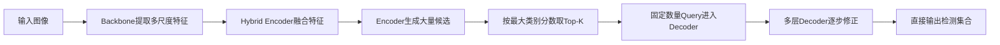
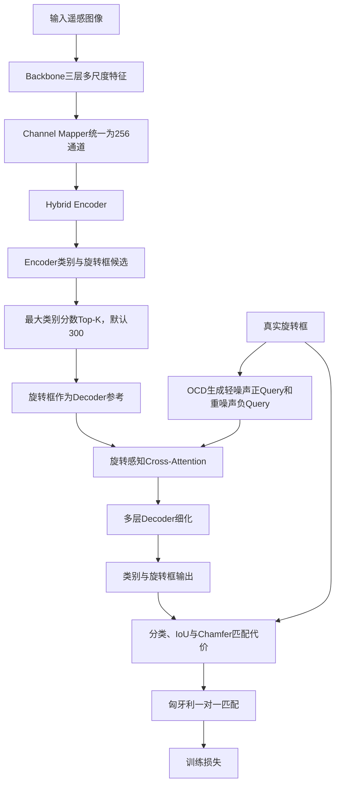
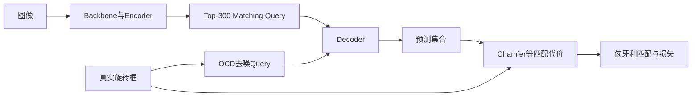
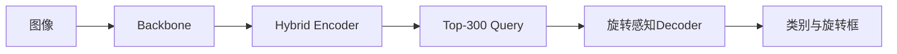
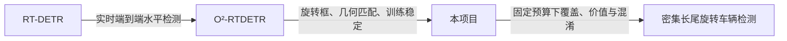

<h1 align="center">O² 实时旋转目标检测 Transformer：论文技术路线与本项目研究衔接</h1>

<p align="center"><strong>从 RT-DETR 到 O²-RTDETR，再到密集长尾场景下的固定预算 Query 研究</strong></p>

<p align="center">
  <a href="https://ieeexplore.ieee.org/document/11424629">IEEE TGRS</a> ·
  <a href="https://arxiv.org/abs/2603.15497">arXiv</a> ·
  <a href="https://github.com/wokaikaixinxin/ai4rs/blob/main/projects/rotated_rtdetr/README.md">官方代码说明</a> ·
  <a href="README.md">研究主页</a> ·
  <a href="README_OFFICIAL.md">原论文与官方工程解读</a> ·
  <a href="README_TEAMWORK.md">团队分工与实验协议</a>
</p>

> [!IMPORTANT]
> 本文档不是论文摘要的简单翻译，而是结合论文正文、方法图、消融实验和当前代码，对技术路线进行通俗化拆解。文中严格区分 **O² 方法家族**、**O²-RTDETR 分支**和**本项目后续创新**。原论文版权及最终解释归原作者所有。

---

## 1. 一句话读懂原论文

传统 RT-DETR 已经能够做到实时、端到端、不需要 NMS，但它最初面向自然图像中的水平框检测。O² 系列的工作是：

> **保留实时 DETR 的高效骨架，把“水平框检测”改造成真正支持任意旋转目标的端到端检测，并重点修复旋转框表示、匈牙利匹配和训练稳定性三个问题。**

原论文没有推翻 RT-DETR，而是在 RT-DETR、D-FINE、DEIM 三条实时 DETR 路线上加入旋转检测机制，形成：

- **O²-RTDETR**：RT-DETR 的旋转检测版本；
- **O²-DFINE**：D-FINE 的旋转检测版本，额外使用角度分布细化 ADR；
- **O²-DEIM**：在 O²-RTDETR 上结合 DEIM 的快速收敛与匹配改进。

这里最容易产生的误解是：**ADR 并不属于当前使用的 O²-RTDETR-R18 基线。** 根据论文表 VII：

- O²-DFINE 使用 OCD、ADR 和 Chamfer Distance Cost；
- O²-RTDETR 使用 OCD 和 Chamfer Distance Cost；
- O²-DEIM 在 O²-RTDETR 基础上继续加入 Matchability-Aware Loss 和多尺度训练。

所以，本项目当前基线更准确的描述是：

> **它继承实时 RT-DETR 主体，引入旋转框预测与旋转感知采样，并以 OCD 稳定训练，以 Chamfer Distance Cost 改善旋转框匹配。**

---

## 2. 专业名词通俗解释

| 名词 | 通俗解释 | 在模型中的作用 |
|---|---|---|
| 水平框 | 边始终平行于横纵轴的矩形 | 普通检测常用表示 |
| 旋转框 | 可以绕中心旋转的矩形 | 贴合任意方向的车辆、飞机和船舶 |
| Query | DETR中的“目标槽位”或“检测名额” | 每个Query尝试负责一个目标；当前默认300个 |
| Encoder | 把多尺度特征整理成候选表示 | 生成并筛选候选目标 |
| Decoder | 让Query从特征中找目标并反复修正 | 输出类别和旋转框 |
| Top-K | 按分数取前K个候选 | O²-RTDETR选300个候选进入Decoder |
| 匈牙利匹配 | 在预测和真值间寻找一对一分配 | 决定训练时每个真值由哪个Query学习 |
| 匹配代价 | 判断预测和真值是否适合配对的分数 | 服务标签分配，不等同于最终损失 |
| NMS | 删除重复预测框的后处理 | RT-DETR希望端到端取消它 |
| 去噪训练 | 给真值框加扰动，要求模型恢复正确目标 | 加速收敛并稳定训练 |
| 残差细化 | 当前层只学习在上一层基础上改多少 | 让Decoder从粗到细修正 |
| 旋转感知采样 | 采样点随目标角度旋转 | 让注意力更贴合倾斜目标 |

---

## 3. 传统 RT-DETR 的基础流程



### 3.1 Backbone：提取多尺度视觉信息

Backbone把图像变成不同分辨率的特征图。高分辨率层保留小目标细节，低分辨率层具有更大的感受野。O²-RTDETR中的ResNet输出相对输入下采样8、16、32倍的三层特征，再用`1×1`卷积统一为256通道。

### 3.2 Hybrid Encoder：兼顾全局关系与效率

完整Transformer在所有位置做全局注意力，计算量很大。RT-DETR把任务拆开：最高层特征用注意力建立全局关系，跨尺度融合则使用更高效的CNN结构。这是它能够实时运行的重要基础。

### 3.3 Query Selection：从大量候选中选300个

Encoder为大量位置预测类别响应和框。RT-DETR对每个候选取所有类别分数中的最大值，进行全局排序，再选出前`K`个：

```text
K = num_queries = 300
```

这些候选框成为Decoder的初始参考框。通俗理解就是：Encoder提交大量“疑似目标”，Top-K只给最有希望的300个进入精修阶段。

### 3.4 Decoder：让Query逐层寻找和修正目标

每层Decoder通常包含：

- **Self-Attention**：Query之间交流，减少重复负责同一目标；
- **Cross-Attention**：Query从图像特征中抽取目标信息；
- **前馈网络**：进一步变换特征；
- **分类与回归头**：更新类别和框。

### 3.5 为什么可以取消NMS

CNN检测器通常生成大量重复框，再用NMS删除。DETR通过匈牙利算法建立一对一训练：一个真值只匹配一个主要预测，一个预测也只负责一个真值。因此模型直接学习输出一个不重复的目标集合，这就是“端到端检测”。

---

## 4. 为什么不能只给 RT-DETR 多加一个角度

把水平框`(cx, cy, w, h)`改成旋转框`(cx, cy, w, h, θ)`只是第一步。旋转还会同时影响四个环节。

### 4.1 角度表示

角度具有周期边界，宽高还可能发生等价交换。视觉上很接近的两个框，角度数值可能跨过边界。直接回归一个精确角度也无法表达“角度大约处于某个范围”的不确定性。

### 4.2 训练匹配

L1参数距离不一定代表真实几何距离：一个中心偏远、IoU为0但角度相同的框，可能比一个位置正确、仅角度稍偏的框得到更小的L1代价。

### 4.3 训练稳定性

训练早期，同一个真值可能在Decoder第一层匹配Query 17，第二层变成Query 83，第三层又变成Query 41。负责人不断变化，会造成监督目标抖动。

### 4.4 特征采样

普通采样布局不随目标旋转。面对斜着停放的车辆，部分采样点可能落到背景。旋转检测不仅要输出角度，也要让Decoder知道应该沿什么方向取特征。

---

## 5. O² 系列完整数据流



需要特别注意：

- Top-K Query Selection仍继承RT-DETR，原论文没有重写它；
- Chamfer Cost和OCD主要改变训练过程；
- 旋转框输出和旋转感知采样改变检测结构；
- ADR属于O²-DFINE，不属于当前O²-RTDETR-R18。

---

## 6. 改动一：旋转框与旋转感知采样

传统RT-DETR输出四参数水平框，O²-RTDETR输出五参数旋转框。论文把角度定义在`[0, π)`，因为矩形旋转180度后几何形状等价。

Cross-Attention采样点还会根据预测角度绕框中心旋转：

- 普通采样像始终水平放置的网格；
- 旋转采样像会跟着车身方向转动的网格；
- 对倾斜目标，后者更容易覆盖目标本身而不是背景。

它解决的是“支持什么框”和“到哪里取特征”的问题，不是简单增加一个角度损失。

---

## 7. 改动二：Chamfer Distance Cost 改善旋转框匹配

### 7.1 改的是训练配对规则

匈牙利匹配通常综合分类代价、IoU代价和距离代价。论文把距离项改为Chamfer Distance Cost。它只服务训练标签分配，不是推理后处理。

### 7.2 计算方式

先把预测框和真值框各自转换成四个角点，然后双向寻找最近点：

1. 每个预测顶点找最近的真值顶点；
2. 每个真值顶点找最近的预测顶点；
3. 汇总两边的平方距离。

双向计算避免一个点集只覆盖另一个点集局部。四个顶点已经表达位置、尺寸和朝向；论文发现继续沿边采样16或32点反而略微降点。

### 7.3 相对其他距离的优势

| 距离 | 主要问题 | Chamfer的改进 |
|---|---|---|
| L1参数距离 | 参数差异不总等于真实几何差异 | 直接比较框在图像中的角点位置 |
| KL散度 | 同中心同尺寸方形框旋转后可能无法区分 | 顶点改变后仍可区分 |
| Hausdorff距离 | 只看最坏点，容易被异常点主导 | 综合所有点的最近邻距离 |

### 7.4 为什么不影响推理速度

Chamfer只用于训练匹配。推理时没有真值，也不执行匈牙利算法。论文中O²-RTDETR-R18加入OCD和Chamfer后，参数量、FLOPs和FPS仍为20M、147G、233 FPS，提升来自训练优化而非扩大网络。

---

## 8. 改动三：OCD 旋转对比去噪

OCD全称Oriented Contrastive Denoising。它不是给图像加噪，而是给真实旋转框加扰动，构造额外训练Query：

- **正去噪Query**加入小扰动，仍接近真值；
- **负去噪Query**加入大扰动，明显偏离真值；
- Decoder学习从近似框恢复目标，并区分错误框。

### 8.1 四种噪声模式

| 模式 | 改动内容 | 论文观察 |
|---|---|---|
| Box Noise | 保持角度，扰动位置和尺寸 | 效果最好，覆盖有效变化 |
| Angle Noise | 只扰动角度 | 变化维度单一，范围较窄 |
| Geometric Noise | 同时扰动框和角度 | 可能过强，IoU下降过多 |
| Probability Noise | 在高斯协方差表示中加噪再恢复框 | 扰动平滑，但对中心等信息监督较弱 |

完全不加噪声也不行：正Query已经等于真值，回归损失为0；相同框又同时充当正负样本，会产生矛盾监督。

论文还测试100、200、300个去噪Query。100增加到200时AP50从75.83%升到76.14%，继续增加到300基本饱和。这些去噪Query只用于训练，不等同于推理时的300个Matching Query。

---

## 9. 不稳定性指标：OCD如何被证明有效

论文记录每个真实目标在各层Decoder中匹配到的Query索引：

- 各层一直匹配同一Query：分配稳定；
- 索引频繁变化：同一目标不断“换负责人”。

不稳定性指标统计这种层间索引变化。论文在DOTA-v1.0训练前12轮比较了Rotated Deformable DETR和不同OCD噪声模式，结果显示OCD显著降低匹配不稳定性。

因此，OCD的证据不只是最终AP上涨，还包括：**Decoder各层的标签分配更加一致。**

---

## 10. ADR：O²-DFINE专属的角度分布细化

> [!WARNING]
> ADR是原论文的重要创新，但属于 **O²-DFINE**，不属于当前 **O²-RTDETR-R18**。本节用于讲透论文家族，不能据此声称当前基线已经使用ADR。

ADR不直接预测一个孤立角度，而是把旋转框拆成：

1. 外接水平矩形；
2. 旋转框顶点相对外接矩形边缘的偏移。

每个框对应六个概率分布：外接矩形左、上、右、下四条边，加两个顶点偏移。模型对多个离散区间给出概率，从而表达定位不确定性。

第一层产生初始旋转框和分布，后续层输出分布logits的残差：

```text
新分布 = Softmax（上一层 logits + 当前层残差 logits）
```

非线性权重函数把分布转换成偏移量：中部变化平滑，适合精细调整；边界变化陡峭，适合预测较差时大幅纠偏。可以理解为同时提供“微调挡”和“快速纠偏挡”。

ADR使用FGL细粒度定位损失监督分布。消融显示分箱数从8增加到32持续改善，`N=32`最好，增加到64或128不再提升；权重函数范围过大或过小也会降点。

---

## 11. 三个O²分支及消融路线

| 分支 | 基础模型 | OCD | Chamfer | ADR | 其他特点 |
|---|---|---:|---:|---:|---|
| O²-RTDETR | RT-DETR | ✓ | ✓ | × | 当前项目主基线 |
| O²-DFINE | D-FINE | ✓ | ✓ | ✓ | 概率分布细化旋转框 |
| O²-DEIM | O²-RTDETR/DEIM | ✓ | ✓ | × | Matchability-Aware Loss与多尺度训练 |

### 11.1 O²-DFINE-s

| 步骤 | AP50 | 参数 | FPS | FLOPs |
|---|---:|---:|---:|---:|
| D-FINE-R-s | 72.44% | 10M | 297 | 60G |
| + OCD | 73.72% | 10M | 297 | 60G |
| + ADR | 75.05% | 10M | 297 | 60G |
| + Chamfer | **76.14%** | 10M | 297 | 60G |

### 11.2 O²-RTDETR-R18

| 步骤 | AP50 | 参数 | FPS | FLOPs |
|---|---:|---:|---:|---:|
| RT-DETR-R-R18 | 73.94% | 20M | 233 | 147G |
| + OCD | 75.72% | 20M | 233 | 147G |
| + Chamfer | **77.31%** | 20M | 233 | 147G |

### 11.3 O²-DEIM-R18

| 步骤 | AP50 | 参数 | FPS | FLOPs |
|---|---:|---:|---:|---:|
| O²-RTDETR-R18 | 77.31% | 20M | 233 | 147G |
| + Matchability-Aware Loss + 多尺度训练 | **79.49%** | 20M | 233 | 147G |

这些结果说明论文主要通过表示、匹配和训练机制涨点，而不是堆叠更大的特征网络。

---

## 12. 训练阶段和推理阶段的区别

### 训练阶段



### 推理阶段



推理时没有真值，因此没有OCD和匈牙利匹配，也不执行Chamfer Cost；同时不使用旋转NMS。这解释了为什么训练优化可以提升性能而几乎不增加部署延迟。

---

## 13. 原论文解决了什么、没有解决什么

### 13.1 已解决的问题

| 原问题 | 论文做法 | 效果 |
|---|---|---|
| RT-DETR只支持水平目标 | 五参数旋转框与旋转采样 | 支持任意方向目标 |
| 旋转NMS有额外延迟和阈值敏感性 | DETR一对一集合预测 | 端到端输出 |
| 旋转框参数距离存在歧义 | 四顶点Chamfer Cost | 匹配更符合真实几何 |
| 训练早期标签分配不稳定 | OCD正负去噪Query | 降低层间匹配切换 |
| 直接角度回归缺少不确定性 | O²-DFINE中的ADR | 分布式逐层细化 |
| 精度与实时性难兼顾 | 优化机制而非扩大网络 | 参数、FLOPs、FPS基本不变 |

### 13.2 尚未解决的问题

1. **Query Selection没有被重写。** 仍是最大类别分数全局Top-K，没有考虑已选候选之间的重复、覆盖和密度。
2. **固定预算可能浪费。** 即使目标数少于300，重复高分候选也可能挤占有效槽位。论文图12(b)还明确展示目标数超过Query时的密集漏检。
3. **OCD不处理类别混淆课程。** 四类噪声围绕几何，不会专门学习Van/Car、Freight Car/Truck等语义混淆。
4. **长尾候选公平性不是论文主问题。** 原论文目标是建立通用实时旋转DETR，不研究少数类如何获得有限Query预算。
5. **最大类别分数不等于候选价值。** 它无法直接表达定位质量、重复程度和Decoder可纠正潜力。

---

## 14. 本项目基线与诊断给出的新证据

DroneVehicle基线最佳权重为第33轮，验证mAP 70.88%，测试mAP 70.82%。测试分类AP为：Car 89.48%、Bus 88.68%、Truck 68.21%、Van 58.18%、Freight Car 49.56%。

### 14.1 Query诊断

| 类别 | K=300几何覆盖 | 类别正确覆盖 | 差距 |
|---|---:|---:|---:|
| Car | 93.19% | 92.44% | 0.75% |
| Truck | 82.71% | 69.09% | 13.62% |
| Bus | 97.74% | 92.68% | 5.06% |
| Van | 95.14% | 58.43% | **36.71%** |
| Freight Car | 90.00% | 53.38% | **36.62%** |

Van和Freight Car多数时候已有候选覆盖其位置，但类别判断严重落后。密集场景中Truck几何覆盖降至71.29%，Freight Car降至85.75%；Van和Freight Car的几何-类别差距扩大到41.35%和44.02%。

Query从300增加到400后，各类几何覆盖只提升0.00到0.42个百分点。因此主要问题不是单纯“300太少”，而是：

> **300个槽位如何被评价、选择和分配。**

### 14.2 角度诊断

测试集IoU≥0.50正确匹配中，总体平均角度误差2.34°、中位数1.59°、P90为5.02°，89.92%的匹配误差不超过5°，各类别平均误差均不超过2.39°。

因此当前证据不支持把角度回归作为主要瓶颈，也不支持优先重写ADR或继续堆叠角度损失。

---

## 15. 本项目相对 O²-RTDETR 的研究方向

原论文回答：

> **怎样让实时RT-DETR正确表示、匹配和学习旋转框？**

本项目接下来回答：

> **在旋转框已经能够稳定学习的基础上，怎样在固定300个Query和实时性约束下，提高密集长尾场景的候选覆盖、候选价值判断和易混类别识别？**

研究定位：**面向密集长尾航拍车辆的质量感知Query分配与混淆鲁棒旋转检测。**

---

## 16. 主创新：密度覆盖约束的固定预算 Query 集合选择

原始Top-K把候选独立打分后排序，不考虑候选之间的关系，可能出现多个高分候选重复覆盖同一明显目标，而密集区域仍有目标没有获得Query。

我们准备把选择过程改写为：

> **在固定300个槽位内，选择一个整体覆盖更充分、空间冗余更低、适应场景密度的候选集合。**

选择候选时同时考虑：

- 能否补充尚未覆盖的区域；
- 与已选候选是否高度重复；
- 当前区域是否密集、是否需要更多预算；
- 定位和语义信息是否具有继续精修价值。

它直接替换RT-DETR/O²-RTDETR的独立Top-K机制，且保持300个Query。它和Chamfer不重复：Chamfer决定训练时预测和真值怎样配对；本方法决定推理前哪些Encoder候选有资格进入Decoder。

---

## 17. 辅助创新一：候选价值学习与分类-定位质量校准

最大类别分数只表示模型对某个类别的信心，不一定表示框定位好、候选不重复或能够被Decoder纠正。诊断中Van和Freight Car几何覆盖高、类别正确覆盖低，正好证明二者存在错位。

我们准备学习一个更完整的候选价值，综合：

- 是否像真实目标；
- 预估定位质量；
- 类别判断稳定性；
- 被Decoder继续纠正的潜力。

先保留普通Top-K，只替换排序依据做独立实验；有效后再作为主创新集合选择的基础信号。

- 辅助创新一回答：**单个候选值不值得保留？**
- 主创新回答：**候选相互影响时，300个槽位整体怎样分配？**

---

## 18. 辅助创新二：混淆驱动的课程式困难候选学习

原OCD解决几何扰动，但不知道当前模型最容易混淆哪些类别。我们准备动态统计困难候选和混淆关系：

1. 前期保证基本定位和训练稳定；
2. 中期加入位置正确但类别易混的候选；
3. 后期重点训练高置信错误、低类别间隔和反复混淆样本。

“课程式”表示难度逐渐增加，不是在第一轮就投入全部最难样本。方法不会永久写死Van、Car、Truck等类别名，而是根据模型当前混淆动态生成训练重点，以提高可迁移性。

它提高语义信息可靠性，为候选价值学习和集合选择提供更好的输入，同时尽量只影响训练，不增加推理开销。

---

## 19. 三代方法完整对比

| 维度 | 传统RT-DETR | 原论文O²-RTDETR | 本项目计划方法 |
|---|---|---|---|
| 场景 | 自然图像水平框 | 遥感旋转框 | 密集长尾航拍车辆旋转框 |
| 框表示 | `(cx,cy,w,h)` | `(cx,cy,w,h,θ)` | 保留O²旋转框 |
| 特征采样 | 水平目标逻辑 | 采样点随角度旋转 | 保留，暂不优先修改 |
| Query数量 | 固定Top-K | 固定300 | 仍固定300，保证公平和效率 |
| Query选择 | 最大类别分数独立Top-K | 继续沿用 | 候选价值学习+集合级覆盖选择 |
| 训练匹配 | 水平框常规代价 | 四顶点Chamfer | 保留，不与主创新重复 |
| 去噪 | 常规去噪 | OCD四种旋转几何噪声 | 保留并扩展混淆课程学习 |
| 角度 | 不支持旋转 | O²-RTDETR旋转框；O²-DFINE有ADR | 诊断显示不是主瓶颈 |
| 主要问题 | 实时端到端检测 | 旋转表示、匹配、训练稳定 | 密集覆盖、候选价值、类别混淆 |
| 效率策略 | 高效Encoder/Decoder | 优化机制而非扩大网络 | 固定Query，控制FPS和显存代价 |



---

## 20. 后续实验需要证明什么

### 主创新

- Query保持300；
- 密集组Truck和Freight Car几何覆盖提高；
- 未覆盖GT和重复候选减少；
- 提升不是靠增加Query或Backbone；
- FPS下降尽量不超过5%到10%。

### 辅助创新一

- 候选价值与真实定位质量的相关性高于最大类别分数；
- 保持普通Top-K时也能独立改善结果；
- Van和Freight Car类别正确覆盖率提高。

### 辅助创新二

- Van、Freight Car、Truck分类AP提升；
- 主要类别混淆下降；
- 训练稳定且推理阶段尽量没有额外开销。

### 完整消融

| 实验 | 候选价值 | 集合选择 | 混淆课程 | 目的 |
|---|---:|---:|---:|---|
| Baseline | × | × | × | O²-RTDETR基线 |
| A | ✓ | × | × | 候选价值独立贡献 |
| B | × | ✓ | × | 集合选择独立贡献 |
| C | × | × | ✓ | 混淆课程独立贡献 |
| A+B | ✓ | ✓ | × | 价值与分配协同 |
| A+C | ✓ | × | ✓ | 价值与语义协同 |
| B+C | × | ✓ | ✓ | 覆盖与语义协同 |
| A+B+C | ✓ | ✓ | ✓ | 完整方法 |

---

## 21. 当前研究边界

现阶段不把以下方向作为主线：

- 单纯把Query从300增加到400；
- 直接扩大Backbone；
- 因为论文讨论角度就继续堆叠角度损失；
- 给少数类写死固定Query配额；
- 分类分数简单乘密度权重后继续普通Top-K；
- 只报告mAP，不分析Query覆盖和实时性。

这些方法可能偶尔涨点，但不能回答诊断已确认的机制问题。

---

## 22. 代码中的关键位置

| 内容 | 代码位置 |
|---|---|
| O²-RTDETR主体 | `projects/rotated_rtdetr/rotated_rtdetr/rotated_rtdetr.py` |
| Decoder | `projects/rotated_rtdetr/rotated_rtdetr/rotated_rtdetr_layers.py` |
| 检测头与损失 | `projects/rotated_rtdetr/rotated_rtdetr/rotated_rtdetr_head.py` |
| 旋转注意力 | `projects/rotated_dino/rotated_dino/rotated_attention.py` |
| 旋转去噪Query | `projects/rotated_dino/rotated_dino/rotated_dino_layers.py` |
| Chamfer匹配代价 | `projects/rotated_dino/rotated_dino/match_cost.py` |
| DroneVehicle基线配置 | `projects/rotated_rtdetr/configs/o2_rtdetr_r18vd_1xb4_36e_cosine_amp_dronevehicle.py` |
| Query诊断 | `tools/analyze_query_selection.py` |
| 角度诊断 | `tools/analyze_angle_robustness.py` |

原始Top-K关键逻辑位于`rotated_rtdetr.py`：对Encoder分类输出取类别最大值，再执行`topk(..., k=self.num_queries)`。后续创新必须通过独立开关和消融实现，不能覆盖原始基线而失去公平对照。

---

## 23. 最终总结

### 原论文的贡献

O²系列不是简单给RT-DETR增加角度输出，而是建立了一条完整实时旋转检测路线：

1. 五参数旋转框和旋转感知采样；
2. Chamfer Cost改善旋转框训练匹配；
3. OCD稳定正负去噪Query和层间标签分配；
4. O²-DFINE用ADR以概率分布细化旋转框；
5. 保持端到端、不依赖旋转NMS，尽量不增加推理成本。

### 本项目的贡献目标

我们不重复解决已经基本解决的旋转匹配问题，而是在O²-RTDETR上继续研究：

1. **主创新：密度覆盖约束的固定预算Query集合选择；**
2. **辅助创新一：候选价值学习与分类-定位质量校准；**
3. **辅助创新二：混淆驱动的课程式困难候选学习。**

> **O²-RTDETR让RT-DETR能够稳定、实时地检测旋转目标；本项目则要让有限的300个Query在密集长尾车辆场景中被更有效地评价、分配和学习。**

---

## 24. 引用

```bibtex
@ARTICLE{11424629,
  author={Ding, Zeyu and Zhou, Yong and Zhao, Jiaqi and Du, Wen-Liang and Li, Xixi and Yao, Rui and Saddik, Abdulmotaleb El},
  journal={IEEE Transactions on Geoscience and Remote Sensing},
  title={Real-Time Oriented Object Detection Transformer in Remote Sensing Images},
  year={2026},
  volume={64},
  number={5613014},
  pages={1-14},
  doi={10.1109/TGRS.2026.3671683}
}
```

论文原文：`D:/Object_Detection/资料整理/Real-Time_Oriented_Object_Detection_Transformer_in_Remote_Sensing_Images.pdf`

本项目基线、诊断结果和创新实验计划见 [README.md](README.md)。
