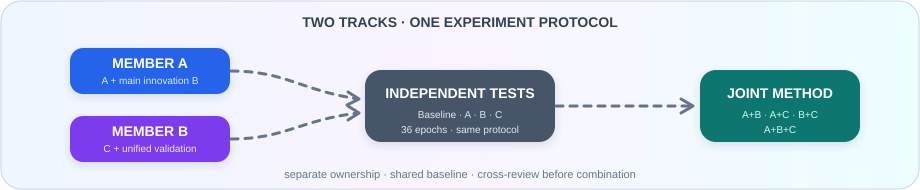

<h1 align="center">O²-RTDETR 两人研究分工与共同实验协议</h1>

<strong>创新归属、阶段任务、实验纪律与协作边界</strong>

  
  
  
  

<strong>📚 项目文档导航</strong>

  
  
  

  

---

本文档用于统一两名成员在 O²-RTDETR × DroneVehicle 项目中的研究边界、创新归属、实验流程和交付标准。技术背景、基线结果与诊断数据以项目主 `README.md` 为准；本文档只负责团队协作和实验管理。

## 1. 当前研究目标

项目以 O²-RTDETR-R18 为基线，在 DroneVehicle RGB 数据集上研究密集、长尾、易混车辆的旋转目标检测。研究必须保持端到端检测框架、R18-vd 骨干和 300 个 Decoder Query，不以增加 Query 数量、扩大 Backbone 或显著增加计算量作为主要提升手段。

当前要解决三个问题：

1. 原始最大类别分数不能完整表示候选是否值得进入 Decoder；
2. 独立全局 Top-K 不考虑候选之间的覆盖和冗余关系，密集场景中的固定 Query 预算利用不足；
3. Van、Freight Car 等少数类候选经常定位正确但分类错误，现有训练对动态类别混淆利用不足。

研究方向统一编号如下：

| 编号 | 研究方向 | 定位 |
|---|---|---|
| A | 候选价值学习与分类—定位质量校准 | 辅助创新一 |
| B | 密度覆盖约束的固定预算 Query 集合选择 | 主创新 |
| C | 混淆驱动的课程式困难候选学习 | 辅助创新二 |

三个方向必须先独立验证，再进行组合实验。最终方法只保留具有稳定增益、明确机制证据和可接受效率代价的部分。

## 2. 总体分工决定

### 2.1 成员 A

成员 A 负责 A 与 B，即候选价值和 Query 集合选择的完整研究链路。A、B 都位于 Encoder 候选进入 Decoder 前的选择路径，关联紧密，由同一人负责可以减少重复理解、接口反复修改和核心文件冲突。

成员 A 要回答两个核心问题：

- 单个候选应如何评价，才能比原始最大类别分数更准确地反映其保留价值；
- 在固定 300 个 Query 的前提下，如何把单候选价值转化为覆盖充分、冗余较低的候选集合。

成员 A 的创新归属：

- 独立负责创新 A 的研究、实现、实验和机制解释；
- 独立负责主创新 B 的研究、实现、实验和机制解释；
- 负责 A+B 的内部联合及其接口一致性；
- 负责与 Query 选择直接相关的诊断指标和效率分析。

成员 A 的主要工作：

1. 调研候选质量估计、质量感知分类、Query 初始化、集合选择、覆盖优化和冗余抑制等方向；
2. 梳理原始 Encoder 候选评分、Top-K 选择和 Decoder Query 初始化的完整数据流；
3. 建立 A 的独立实验，使其能够在不启用 B、C 时单独训练和评估；
4. 建立 B 的独立实验，使其能够在不依赖 A、C 时验证固定预算集合选择；
5. 分析几何 Recall@300、类别正确 Recall@300、未覆盖 GT、候选冗余和密集场景覆盖；
6. 完成 Baseline、A、B、A+B 四组核心实验；
7. 记录参数量、显存、训练耗时、推理延迟和 FPS 变化；
8. 整理方法原理、Query 机制图、A/B 消融和对应论文材料。

成员 A 的完成标准：

- A 和 B 均可独立启用、关闭并复现实验；
- A 的收益能够通过排序或质量一致性指标解释；
- B 的收益能够通过密集覆盖、冗余或 Query 利用率解释；
- A+B 的结果能够判断二者是互补、重复还是相互冲突；
- Query 保持 300，速度和显存变化有完整记录；
- 不把单纯增加计算量作为创新效果。

### 2.2 成员 B

成员 B 负责 C 以及整个项目的实验验证体系。C 主要位于训练监督和困难候选学习路径，与 A、B 的 Query 选择核心路径相对独立。成员 B 同时承担统一评估、稳定性、泛化和结果汇总，使两人的总体工作量保持接近。

成员 B 要回答两个核心问题：

- 如何利用模型训练过程中真实产生的类别混淆，改善几何正确但语义错误的困难候选；
- 如何用一致、可复现的实验体系判断 A、B、C 及其组合是否真正有效。

成员 B 的创新归属：

- 独立负责创新 C 的研究、实现、实验和机制解释；
- 负责困难候选、类别混淆和少数类性能分析；
- 负责全项目实验记录、对比评估、稳定性和跨数据集验证；
- 负责组合实验的组织与最终结果表，但不代替成员 A 修改 A/B 核心逻辑。

成员 B 的主要工作：

1. 调研课程学习、动态困难样本、混淆感知训练、长尾识别和细粒度类别判别等方向；
2. 梳理现有困难候选训练、分类监督和训练阶段调度的数据流；
3. 建立 C 的独立实验，使其能够在原始 Query Selection 下单独训练和评估；
4. 建立统一的实验记录结构、结果表和评估口径；
5. 分析 Van→Car、Freight Car→Truck 等主要混淆关系、高置信错误和类别正确覆盖；
6. 完成 Baseline、C 以及需要统一验证的组合实验；
7. 执行多次随机种子、效率、显存、稳定性和失败案例分析；
8. 在 DroneVehicle 结论稳定后完成 L315 辅助泛化验证；
9. 整理实验设置、主结果、消融、泛化、稳定性和失败分析等论文材料。

成员 B 的完成标准：

- C 可以独立启用、关闭并复现实验；
- C 的提升能由混淆矩阵、类别 AP 或高置信错误变化解释；
- Car 和 Bus 等优势类别没有不可接受的退化；
- 每项正式结果都能追溯到配置、日志、权重和评估输出；
- 组合实验使用相同基线条件和统计口径；
- L315 只用于泛化验证，不反向替代 DroneVehicle 主结论。

## 3. 共同职责

以下工作必须由两人共同确认，任何一人不能单独改变结论口径：

1. 冻结正式基线和固定实验条件；
2. 确认 A、B、C 的开关边界和组合方式；
3. 审查对方模块是否改变了未声明的基线设置；
4. 共同分析 A+C、B+C、A+B+C 的交互结果；
5. 决定最终论文保留哪些模块，不以单次最好结果作为唯一依据；
6. 共同核对最终表格、图、配置、权重和文字结论；
7. 共同维护重要产物清单和最终归档。

如出现以下情况，必须暂停正式长训练并共同讨论：

- 模块边界发生变化，开始同时修改对方负责的核心路径；
- 固定实验条件需要改变；
- 短期结果与机制指标明显矛盾；
- 组合实验出现大幅退化或训练不稳定；
- 测试集被误用于选择超参数、轮次或模块；
- 两人的结果无法在同一配置和评估口径下复现。

## 4. 共同实验协议

### 4.1 固定基线设置

除非两人共同批准并在实验记录中明确标注，以下设置不得改变：

| 项目 | 固定设置 |
|---|---|
| 主数据集 | DroneVehicle RGB |
| 数据划分 | 现有 Train / Validation / Test |
| 模型基线 | O²-RTDETR-R18-vd |
| 输入尺寸 | 保持长宽比缩放并填充至 1024 × 1024 |
| Decoder Query | 300 |
| 物理 batch size | 4 |
| 梯度累积 | 2 |
| 有效 batch size | 8 |
| 优化器 | AdamW |
| 训练轮数上限 | 36 |
| 学习率策略 | 线性预热加余弦退火 |
| 混合精度 | AMP 开启 |
| 验证频率 | 每轮验证 |
| 权重选择 | Validation mAP 最优权重 |
| 最终测试 | 只对冻结后的正式方案执行 |

正式基线为 36 轮训练，Validation 最佳权重为 `epoch_33.pth`。当前基线结果为 Validation mAP 70.88%，Test mAP 70.82%。这些数值用于比较，不允许因创新实验重新定义基线。

### 4.2 数据使用协议

- Train 只用于参数训练和训练期统计；
- Validation 用于选择权重、比较方案、调整超参数和机制诊断；
- Test 只用于基线和最终冻结方案的正式报告；
- 不允许根据 Test 结果选择模块、超参数、训练轮次或随机种子；
- 密集、稀疏、类别子集等分析必须使用固定划分规则，不得为某次实验临时修改；
- L315 作为辅助泛化数据集，不参与 DroneVehicle 方法设计阶段的反复调参。

### 4.3 实验晋级流程

每个新方案按以下顺序推进：

1. 完成静态代码、配置和模块开关检查；
2. 使用少量图片完成前向和评估接口检查；
3. 完成 1 轮冒烟训练，检查 loss、梯度、AMP、显存和输出；
4. 完成 6 轮或 12 轮趋势实验；
5. 只有趋势稳定且关键指标呈正向变化时，才能进入完整 36 轮训练；
6. 正式 36 轮实验必须从统一初始化重新训练，不能把短实验直接续训成正式结果；
7. 完整训练后使用 Validation 最优权重评估；
8. 只有最终冻结方案才能进入 Test 和 L315 泛化验证。

短实验的作用是排除明显无效或不稳定方案，不能替代完整训练结论。

### 4.4 公平对比协议

- 对照实验必须使用相同数据划分、输入、训练轮数、优化器、学习率策略和有效 batch；
- 正式对比尽量使用同一初始化或明确记录预训练权重来源；
- 一次实验只改变记录中声明的因素；
- A、B、C 必须分别具有独立开关，禁止用无法拆分的实现直接报告组合收益；
- 组合实验必须建立在各独立模块已完成验证的基础上；
- 如果某模块增加参数量或推理计算，必须同时报告精度和效率变化；
- 不允许只报告最佳一次结果，关键结论应补充多随机种子或重复实验；
- 失败实验也要保留配置、主要指标和失败原因，防止重复尝试。

### 4.5 权重与轮次选择协议

- 所有方案的训练上限统一为 36 轮；
- 每轮在 Validation 上评估；
- 每个方案使用自身 Validation mAP 最优轮次的权重进行正式比较；
- 不强制所有方案都使用第 33 轮，第 33 轮只属于当前基线的最优权重；
- 余弦退火完整实验不通过随意续训改变训练周期；
- 若必须改变周期或学习率计划，该实验应视为新的实验系列，不能与固定协议结果直接混用。

### 4.6 必须记录的实验信息

每次进入 6/12 轮或 36 轮的实验都必须记录：

- 实验编号、日期、负责人和研究假设；
- 对应模块及其开关状态；
- Git 提交号或代码版本标识；
- 完整配置文件路径和相对基线的改动；
- 数据集、随机种子、初始化权重和运行环境；
- 开始时间、结束时间和训练耗时；
- 每轮训练日志与 Validation 指标；
- 最佳轮次、最佳权重路径和权重哈希；
- 总体 mAP、各类别 AP 和必要的机制指标；
- 参数量、显存、延迟、FPS 或训练成本变化；
- 异常、失败原因和下一步判断。

大型权重、预测文件和日志通常不提交 Git，但必须在共享存储中保留，并在记录中写明位置和哈希。

### 4.7 统一评价指标

所有正式实验至少报告：

| 指标组 | 必须报告的内容 |
|---|---|
| 总体精度 | Validation mAP；最终冻结方案的 Test mAP |
| 分类结果 | Car、Truck、Bus、Van、Freight Car 的 AP 和 Recall |
| Query 机制 | 几何 Recall@300、类别正确 Recall@300、未覆盖 GT、候选冗余 |
| 场景子集 | 稀疏、中等、密集场景结果，重点报告密集场景 |
| 混淆结果 | 主要类别对错误、高置信错误、混淆矩阵或等价统计 |
| 效率结果 | 参数量、显存、训练耗时、推理延迟和 FPS |
| 稳定性 | NaN/Inf、梯度、AMP loss scale、显存增长和重复实验波动 |

不同模块可增加专属指标，但不能用专属指标替代共同指标。

### 4.8 成功与停止标准

创新方向进入下一阶段至少应满足：

- 完整 36 轮结果相对基线呈稳定正向变化，或关键机制指标获得明确改善；
- 提升与该模块要解决的问题一致；
- 优势类别没有出现无法解释的大幅下降；
- 推理开销仍符合轻量和实时研究定位；
- 结果可在相同配置下复现。

出现以下情况时应停止继续堆叠该方案：

- 多次实验均无正向趋势；
- mAP 小幅波动但机制指标没有改善；
- 提升主要来自额外 Query、更大 Backbone 或明显增加计算；
- 只改善个别样本，整体或密集子集持续下降；
- 训练长期不稳定且无法明确定位原因；
- 模块与其他创新高度重复，无法形成独立贡献。

研究目标中的“总 mAP 提升 2～5 个百分点”等数值只用于判断潜力，不是必须达到的承诺，也不能替代统计和机制证据。

## 5. 分阶段执行计划

### 阶段 0：冻结基线与协作边界

成员 A：

- 确认原始 Query 选择链路和 A/B 的代码边界；
- 保存基线 Query 诊断结果及对应脚本版本。

成员 B：

- 确认 C 的训练监督边界和统一评估入口；
- 建立实验台账、目录规则和结果表模板。

共同完成：

- 确认固定基线配置、`epoch_33.pth` 和基线指标；
- 确认 A、B、C 的编号、负责人和开关边界；
- 确认共享产物位置、命名方式和评估口径。

阶段交付物：基线快照、分工确认、统一实验记录模板和固定指标清单。上述内容未完成前，不进入正式创新训练。

### 阶段 1：独立文献调研与问题定义

成员 A：围绕候选价值、质量估计、Query 选择、集合覆盖和冗余控制完成 A/B 调研，形成候选方案比较和风险清单。

成员 B：围绕动态混淆、课程学习、困难样本和长尾分类完成 C 调研，同时整理可用于统一评价的指标和统计方法。

共同完成：交流调研结论，检查 A/B/C 是否重复，明确每个方向的研究假设、预期改善指标和失败判据。

阶段交付物：A/B 调研笔记、C 调研笔记、三个方向的实验假设卡。此阶段不要求确定最终具体模块。

### 阶段 2：A 与 C 独立验证

成员 A：先完成 A 的独立研究，保持原始集合选择方式，重点验证候选价值是否优于最大类别分数。

成员 B：完成 C 的独立研究，保持原始 Query Selection，重点验证少数易混类别和高置信错误是否改善。

共同完成：检查两组实验是否遵守固定协议，比较二者是否修改了重叠的监督信号或数据流。

阶段交付物：A 和 C 的 1 轮、6/12 轮结果；趋势通过后再提交各自 36 轮结果、机制分析和效率记录。

### 阶段 3：B 与统一验证体系

成员 A：研究并验证 B，重点解决固定 300 个 Query 下的密集覆盖和候选冗余问题。B 首先应能独立于 A 运行，之后再考虑 A 提供候选基础价值。

成员 B：完善统一评估体系，固定密度分组、混淆统计、效率测量、稳定性检查和结果汇总方式；同时补齐 C 的机制分析。

共同完成：检查 B 是否真正改变集合选择逻辑，确认其收益不是简单分数重加权或额外计算带来的。

阶段交付物：B 的独立结果、Query 机制对照、统一评估脚本或流程、C 的完整分析。

### 阶段 4：完成独立模块矩阵

成员 A：整理 Baseline、A、B 的同口径结果，补齐 A/B 必要消融。

成员 B：整理 Baseline、C 的同口径结果，复核所有独立实验的记录完整性。

共同完成：对 Baseline、A、B、C 做第一次正式评审，决定每个模块是保留、修改还是停止。

阶段交付物：四组独立实验总表、独立机制证据、效率表和阶段决策记录。未通过独立验证的模块不得直接依赖组合结果“证明有效”。

### 阶段 5：A+B 内部联合

成员 A：负责 A+B 的接口和训练，判断候选价值与集合选择是互补还是重复，并完成相应消融。

成员 B：按统一协议独立复核 A+B 的精度、机制和效率结果，不修改 A/B 核心实现。

共同完成：确定后续组合实验使用 A、B、A+B 中的哪些版本。

阶段交付物：A+B 完整结果、与 A/B 的差异分析和联合版本冻结记录。

### 阶段 6：跨负责人组合实验

按以下顺序进行组合，避免同时修改多个因素：

1. A+C，用于判断候选价值和混淆学习是否协同；
2. B+C，用于判断密集覆盖和语义判别是否协同；
3. A+B+C，用于验证完整方法。

成员 A 负责 A/B 侧接口、Query 机制分析和相关故障定位。成员 B 负责 C 侧接口、训练组织、统一评估和结果汇总。任何跨模块接口变更都需要双方审查。

阶段交付物：三组组合实验、与独立模块的增量对照、交互冲突记录和完整方法候选版本。

### 阶段 7：消融、稳定性与效率

成员 A：负责 A/B 内部组件消融、Query 数量固定证明、覆盖—冗余分析和推理开销拆解。

成员 B：负责 C 内部组件消融、多随机种子、混淆变化、训练稳定性、总体效率复核和失败案例。

共同完成：确认最终保留模块，冻结 DroneVehicle 最终配置和 Validation 最优权重。

阶段交付物：消融表、随机种子结果、效率表、稳定性报告、失败案例和最终配置。

### 阶段 8：L315 泛化验证

成员 A：确认最终 A/B 相关模块无需针对 L315 改写机制或硬编码类别规则。

成员 B：负责 L315 的正式训练、评估、结果记录和与 L315 基线的对照。

共同完成：判断方法是否具有跨数据集一致性，并如实记录无提升或退化情况。

阶段交付物：L315 泛化结果、配置、日志、权重和结论。不得用 L315 重新选择 DroneVehicle 上的最终方案。

### 阶段 9：最终归档与论文材料

成员 A：整理方法部分、A/B 原理、Query 机制图、A/B 消融和效率解释。

成员 B：整理实验设置、主结果、C 原理、组合实验、泛化、稳定性和失败分析。

共同完成：核对全部数字和图表，统一术语，确认每个结论都有对应实验，整理可复现代码、配置和产物清单。

阶段交付物：最终结果总表、论文图表、方法说明、实验说明、复现清单和归档目录。

## 6. 实验矩阵与负责人

| 实验 | A | B | C | 主执行人 | 复核人 | 主要目的 |
|---|---:|---:|---:|---|---|---|
| Baseline | × | × | × | 成员 B 统一复核 | 双方 | 固定比较起点 |
| A | ✓ | × | × | 成员 A | 成员 B | 验证候选价值 |
| B | × | ✓ | × | 成员 A | 成员 B | 验证固定预算集合选择 |
| C | × | × | ✓ | 成员 B | 成员 A | 验证混淆课程学习 |
| A+B | ✓ | ✓ | × | 成员 A | 成员 B | 验证 A 与 B 的协同 |
| A+C | ✓ | × | ✓ | 双方 | 双方 | 验证候选价值与语义协同 |
| B+C | × | ✓ | ✓ | 双方 | 双方 | 验证覆盖与语义协同 |
| A+B+C | ✓ | ✓ | ✓ | 双方 | 双方 | 验证完整方法 |

主执行人负责配置、运行、日志和初步分析；复核人负责检查固定条件、重算关键指标和确认结论。复核不等于重新实现对方模块。

## 7. 代码协作与冲突控制

### 7.1 文件所有权原则

- 成员 A 优先修改 Encoder 候选评分、Query 选择和 Decoder 初始化前的 A/B 核心路径；
- 成员 B 优先修改 C 的困难候选训练、动态混淆统计和统一评估路径；
- 公共配置、注册入口、通用数据结构和共享工具属于共同文件；
- 修改共同文件前先说明目的，合并前由另一人检查；
- 不直接重写对方正在开发的核心模块。确需修改时，先约定接口和责任人。

### 7.2 分支与提交原则

- A、B、C 使用独立开发分支或明确隔离的工作区；
- 每次提交只完成一个可解释的改动，避免把格式化、重构和实验逻辑混在一起；
- 配置文件按模块和实验编号区分，不覆盖已有正式配置；
- 合并前至少完成前向测试和 1 轮冒烟训练；
- 组合实验从已冻结的模块版本创建，不直接从未完成的开发分支拼接；
- 发生冲突时按模块负责人处理核心逻辑，另一人负责复核接口和实验条件。

### 7.3 产物命名原则

实验名称至少应包含数据集、模块组合、训练轮数、关键版本和随机种子。配置、工作目录、日志、权重和结果表使用同一实验编号。禁止使用 `new`、`final2`、`test_ok` 等无法追溯的名称。

建议每个正式实验目录至少包含：

- 完整配置副本；
- 训练日志；
- 每轮验证结果；
- 最佳权重信息；
- 最终评估结果；
- 环境与代码版本；
- 一份简短结论记录。

## 8. 工作量平衡

| 工作类别 | 成员 A | 成员 B |
|---|---|---|
| 文献调研 | A 与 B | C 与实验评价方法 |
| 创新研究 | A、主创新 B | C |
| 核心分析 | 候选价值、覆盖、冗余、Query 利用率 | 混淆、困难样本、少数类、稳定性 |
| 独立实验 | A、B | C 与统一 Baseline 复核 |
| 组合实验 | 主导 A+B，参与其余组合 | 组织跨模块组合并统一评估 |
| 消融 | A/B 内部消融 | C 内部消融与多随机种子 |
| 效率 | Query 路径开销拆解 | 全模型效率与资源复核 |
| 泛化 | 确认 A/B 通用性 | 主执行 L315 |
| 论文材料 | 方法、Query 机制、A/B 结果 | 实验、C、组合、泛化与稳定性 |

工作量不按“创新数量”简单计算。成员 A 承担两个高度相关的创新和核心 Query 路径，成员 B 承担一个创新以及全项目实验验证、组合管理、稳定性和泛化工作，两条工作线的任务量应保持接近。

## 9. 阶段评审清单

每个阶段结束时，两人共同回答以下问题：

- 本阶段要解决的问题是否已经回答；
- 结果是否来自固定实验条件下的公平对比；
- 指标变化是否与研究假设一致；
- 是否存在未记录的配置、代码或数据变化；
- 是否有足够证据进入下一阶段；
- 哪些失败结果需要保留，哪些方案应停止；
- 下一阶段的输入版本、负责人和交付物是否明确。

评审结论只允许为“通过”“修改后重测”或“停止”。不能以口头印象代替实验记录。

## 10. 最终交付物

项目完成时至少保留以下内容：

1. 固定基线配置、最佳权重信息、日志和完整指标；
2. A、B、C 及全部正式组合的配置、日志、最佳权重信息和结果；
3. Query 诊断、密度子集、混淆矩阵、效率和稳定性分析；
4. 多随机种子与必要消融结果；
5. DroneVehicle 最终结果和 L315 泛化结果；
6. 最终结果总表、图表和失败实验记录；
7. 代码版本、运行环境、权重哈希和产物位置；
8. 方法说明、实验说明和完整复现清单。

## 11. 当前执行顺序

当前默认顺序为：

1. 冻结基线和协作边界；
2. 两人分别完成 A/B 与 C 的文献调研；
3. 成员 A 验证 A，成员 B 同期验证 C；
4. 成员 A 继续验证 B，成员 B 完善统一评价体系；
5. 完成 Baseline、A、B、C 四组独立实验评审；
6. 完成 A+B；
7. 依次完成 A+C、B+C 和 A+B+C；
8. 完成消融、随机种子、效率和稳定性验证；
9. 完成 L315 泛化验证；
10. 冻结最终结果并整理论文与复现材料。

如果独立实验表明某个方向无效，应停止该方向或重新定义问题，不因既定分工而强行把所有模块放入最终方法。

## 12. 文档维护规则

- 本文件记录长期稳定的分工、协议和阶段计划；
- 主 `README.md` 记录研究背景、基线、诊断结论和方法方向；
- 每次改变创新归属、固定实验条件、阶段顺序或评价口径时，必须同步更新本文件；
- 普通实验进度和临时结果写入实验台账，不在本文件中逐次追加；
- 两人对本文件内容有共同解释权，存在分歧时以最新共同确认的提交记录为准。
